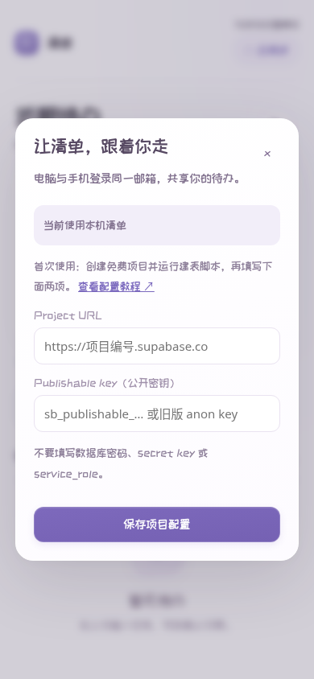

# 电脑、手机同步清单

网站：https://joey-wang-ui.github.io/-Joey/

未登录时，待办仍只保存在当前浏览器。云同步需要你自己的免费 Supabase 项目，以下操作只做一次。

## 1. 创建免费项目

打开 https://supabase.com/dashboard ，登录后点 **New project**。选择组织、填写项目名和数据库密码、选择地区，再点 **Create new project**。数据库密码自己保存，不要填到网页里，也不用发给别人。

## 2. 创建待办表和权限

在项目左侧打开 **SQL Editor → New query**，把本仓库 [supabase/schema.sql](supabase/schema.sql) 的全部内容复制进去，点 **Run**。

脚本只创建 `joey_todos` 表、索引和按账号隔离的 RLS 权限，不导入待办、不清空其他表。请保持 RLS 开启；不能只建表而不创建权限。

## 3. 设置邮箱验证码

打开 **Authentication → Email Templates（部分界面在 Notifications → Email）→ Magic Link**。

把邮件正文改为下面内容并保存：

```html
<h2>登录你的清单</h2>
<p>本次登录验证码：<strong>{{ .Token }}</strong></p>
<p>请回到清单网页输入验证码。</p>
```

若界面另外显示 **Confirm signup** 模板，也把其正文设为上面的验证码内容，供首次注册使用。保持 Email 登录与新用户注册开启。验证码位数以项目配置为准，本网页接受 6～10 位数字。

Supabase 自带的测试邮件服务可能只允许项目团队成员邮箱，并有发送频率限制。先使用你创建项目时的邮箱测试；如果仍不能收信，在 **Authentication → SMTP Settings / Email → SMTP** 配置自己的邮件服务。发信的 SMTP 密码只填 Supabase 后台。生产使用建议配置 SMTP。检查垃圾邮件，重发至少间隔一分钟。

## 4. 把公开配置填进网页

在项目 **Settings → API Keys** 复制 **Publishable key**（以 `sb_publishable_` 开头），在 **Settings → Data API** 或项目的 **Connect → App Frameworks** 找到 **Project URL**（`https://项目编号.supabase.co`）。旧版界面里的 **anon / public** key 也支持。

回到清单网页，点右上角 **☁ 云同步**，填 Project URL 与 Publishable key，点 **保存项目配置**。



**不要填 `sb_secret_…`、`service_role`、数据库密码或连接串。** 网页使用的 publishable / anon key 是公开标识，真正的数据权限由登录会话和 RLS 决定。

首次配置保存在当前浏览器。电脑和手机分别填同一个项目的这两项，再用**同一邮箱**收验证码、登录。只填写公开配置不会自动上传本机任务。

## 5. 导入旧任务并验证同步

登录后，打开 **云同步 → 导入本机 N 条待办**。本机副本会保留；同一浏览器重复导入会跳过云端仍存在的已导入项，不覆盖云端的修改。若云端已删除某条旧任务，再次导入会重新创建它。

在电脑添加一条「同步测试」，在手机登录相同邮箱，点击 **刷新**，应该看到它。在手机标记完成后，电脑点击刷新也应看到完成状态。在线时每 15 秒自动更新，回到页面时也会刷新。多台设备同时修改同一字段时，以数据库最后收到的修改为准。

**退出云端，返回本机清单**只退出这台设备，云端数据保留。云端模式断网时操作会报错，输入保留；不会把云端任务悄悄改存到本机。此版本没有离线写入队列。同步前请确认页面显示「已同步」。

## 以后手机不想手填项目配置

可以把上面两项公开配置填到源项目 `static/cloud-config.js`，保持 JSON 双引号格式：

```js
window.TodoCloudConfig = { "url": "https://项目编号.supabase.co", "key": "sb_publishable_公开值" };
```

执行 `python scripts/build_page.py`，将生成的 `index.html` 更新到公开仓库。手机和电脑刷新后直接登录邮箱即可。构建会拒绝服务端密钥。现有浏览器手动保存的配置优先；需要改项目时，先退出，再在云同步窗口点 **更换项目配置**。

## 当前验证范围

代码包含官方 Supabase JS SDK，页面不从 CDN 加载脚本。已用隔离数据库验证 RLS，并用模拟服务验证双设备操作；在你创建并配置项目之前，真实收信、真实数据库连接和真实设备同步仍需按第 5 步验收。
